# КТ6

## Чек-лист

1. `GET /todoitems/complete`. Начальные данные: две задачи с `isComplete=false` и две с `isComplete=true`. Ожидается `200 OK`, массив из двух задач с `isComplete=true`;
2. `PATCH /todoitems/{id}`. Начальные данные: одна задача с `isComplete=false`. Тело запроса - `{"isComplete": true}`, ожидается `204 No Content`, сохранение `name` и изменение `isComplete`. Проверка результата запросом `GET /todoitems/{id}`;
3. `PUT /todoitems/{id}`. Начальные данные: одна задача с `isComplete=false`. Тело запроса - `{"isComplete": true}`, ожидается `204 No Content`, сохранение `name` и изменение `isComplete`. Проверка результата запросом `GET /todoitems/{id}`;
4. `DELETE /todoitems/{id}`. Начальные данные: одна задача. Ожидается `204 No Content` и удаление задачи. Проверка результата запросом `GET /todoitems/{id}`;
5. `DELETE /todoitems/{id}`. Начальные данные: задача с указанным ID уже удалена. Ожидается `204 No Content`;
6. `POST /todoitems`. Начальные данные: одна задача с `name="foo"`. Тело запроса - `{"name": "foo", "isComplete": false}`. Ожидаемый результат: `409 Conflict`.

## Запросы и проверки

| Endpoint | Тело | Ожидаемый результат | Реальный результат |
|--------|------|---------------------|--------------------|
| `POST /todoitems` | `{"name": "foo", "isComplete": false}` | `201 Created` | `201 Created` |
| `POST /todoitems` | `{"name": "foo", "isComplete": false}` | `409 Conflict` | `201 Created` |
| `POST /todoitems` | `{"name": "bar", "isComplete": false}` | `201 Created` | `201 Created` |
| `POST /todoitems` | `{"name": "baz", "isComplete": true}` | `201 Created` | `201 Created` |
| `POST /todoitems` | `{"name": "quu", "isComplete": true}` | `201 Created` | `201 Created` |
| `GET /todoitems/complete` | - | `200 OK`, `[{"id": 3, "name": "baz", "isComplete": true}, {"id": 4, "name": "quu", "isComplete": false}]` | `200 OK`, `[{"id": 3, "name": "baz", "isComplete": true}, {"id": 4, "name": "quu", "isComplete": false}]` |
| `PUT /todoitems/1` | `{"isComplete": true}` | `204 No Content` | `204 No Content` |
| `GET /todoitems/1` | - | `200 OK`, `{"id": 1, "name": "foo", "isComplete": true}` | `200 OK`, `{"id": 1, "name": null, "isComplete": true}` |
| `PATCH /todoitems/2` | `{"isComplete": true}` | `204 No Content` | `204 No Content` |
| `GET /todoitems/2` | - | `200 OK`, `{"id": 2, "name": "bar", "isComplete": true}` | `200 OK`, `{"id": 2, "name": "bar", "isComplete": true}` |
| `DELETE /todoitems/1` | - | `204 No Content` | `204 No Content` |
| `DELETE /todoitems/1` | - | `204 No Content` | `404 Not Found` |
| `GET /todoitems/1` | - | `404 Not Found` | `404 Not Found` |

## Как исправить

- Проверять название задачи в `POST /todoitems`;
- Убрать endpoint `PUT /todoitems/{id}` или изменить его описанное действие для соответствия реализации; по черновику он дублирует `PATCH /todoitems/{id}`;
- Выдавать `204 No Content` при удалении задачи, даже если задача не существует.

## Скриншоты

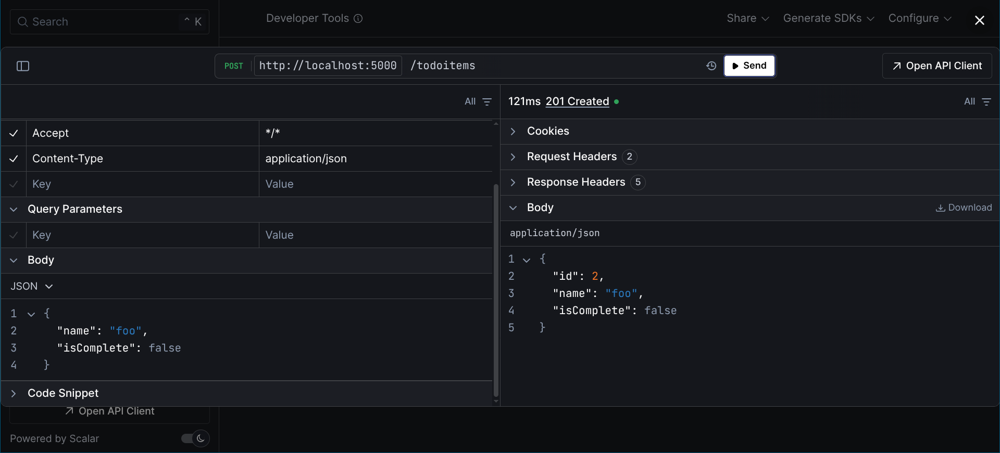
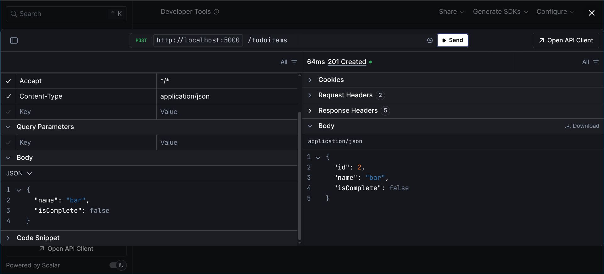
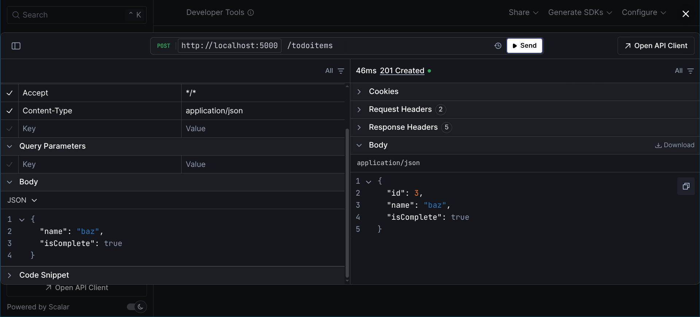
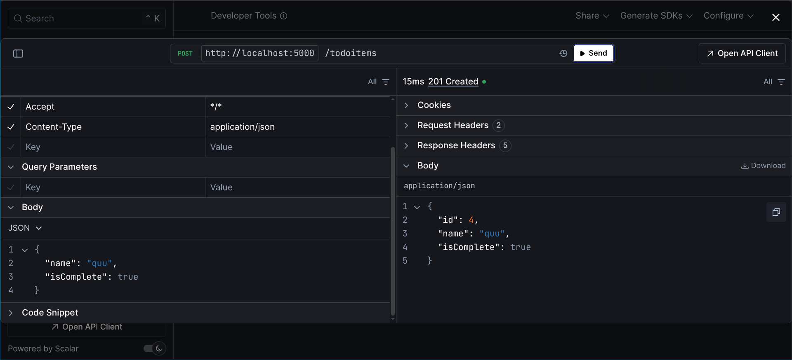
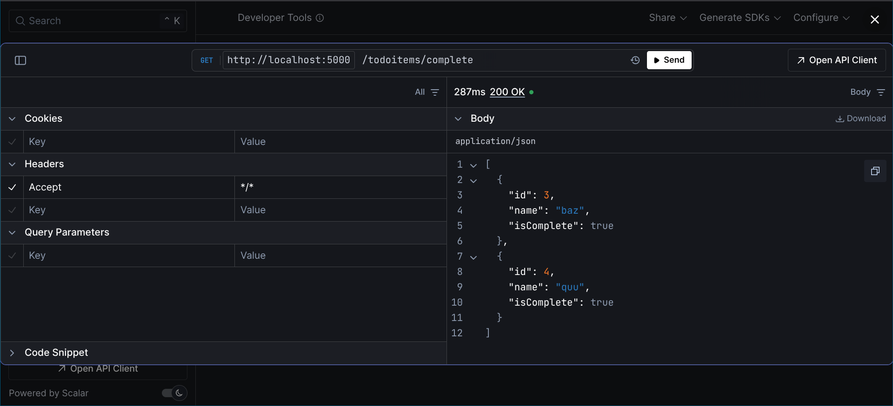
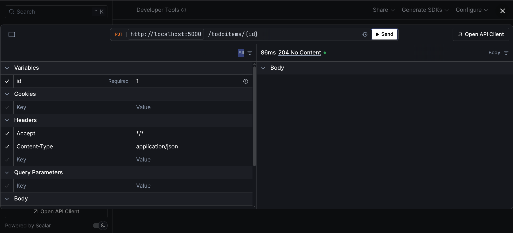
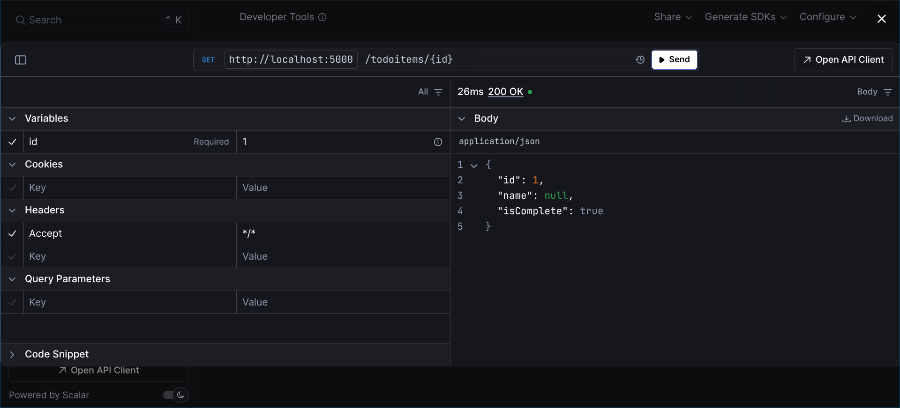
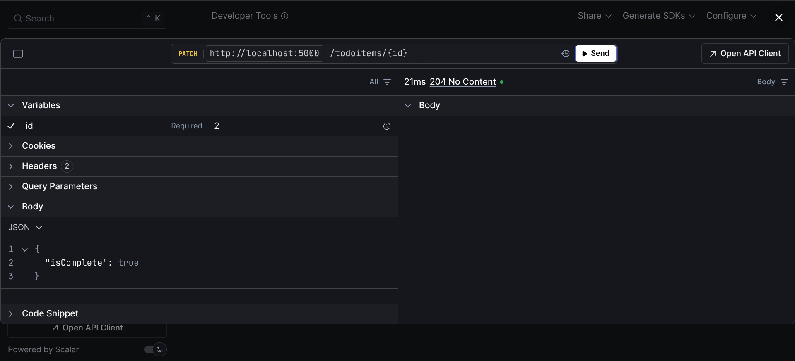
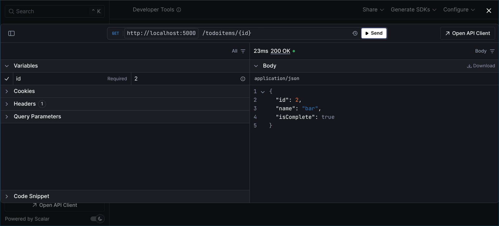
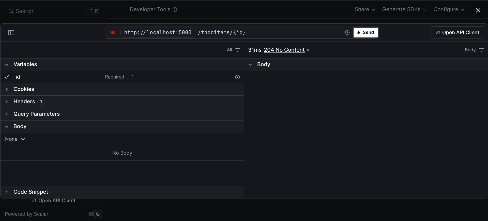
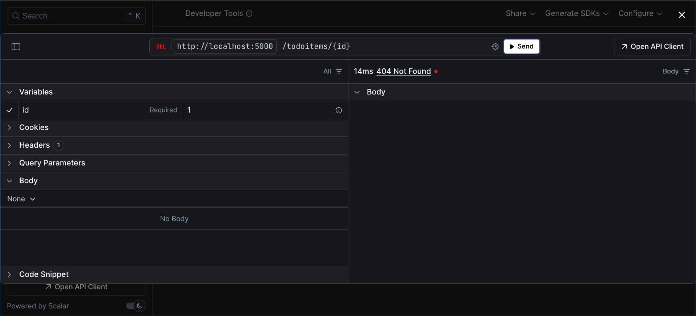
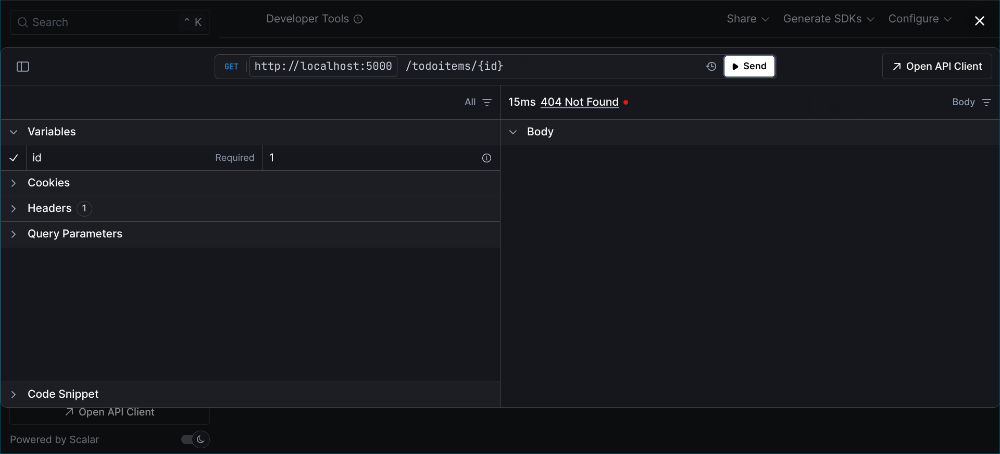
